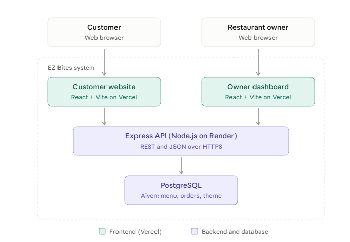
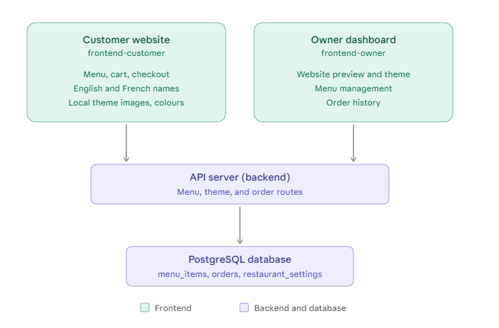
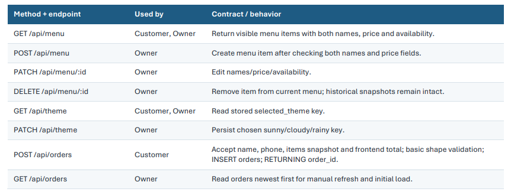
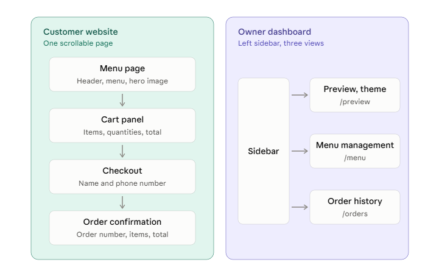
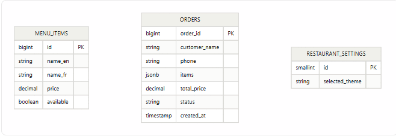
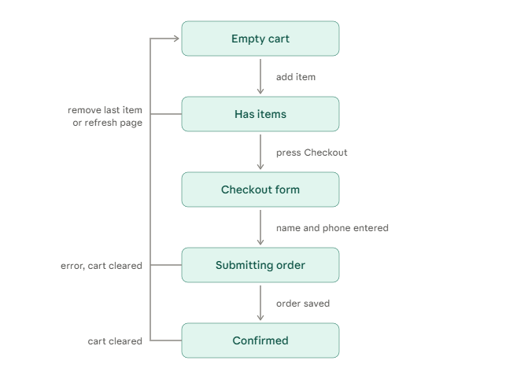
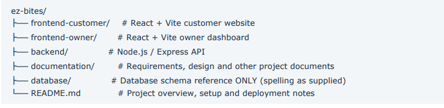
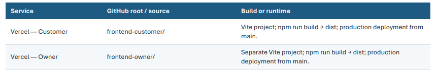
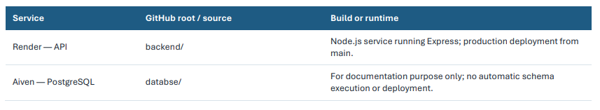
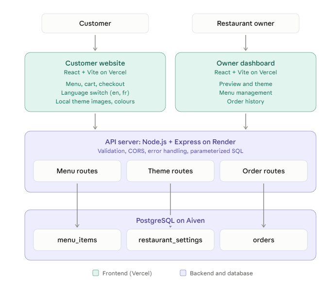

# CSCI 265 Product Design

## Team name: 4 Tiny Stars

## Project/product name: EZ Bites

## Contact person

- Jiamiao Zhao, jiamiao.zhao@my.viu.ca main contact
- Mira Milat, mira.milat@my.viu.ca
- Chengan Tian, chengan.tian@my.viu.ca
- Brahmi Duklan, brahmi.duklan@my.viu.ca

# Table of Contents

1. [ Known issues/omissions ](#section1)

2. [ Product overview ](#section2)

3. [ Core design influences ](#section3)

4. [ System context ](#section4)

5. [ Architectural design ](#section5)

6. [ Module descriptions ](#section6)

7. [ Data design ](#section7)

8. [ Game state and flow of play ](#section8)

9. [ Transition to physical design ](#section9)

10. [ Appendix: the grand design ](#section10)

# List of Figures

A. [ Context diagram ](#figa)

B. [ Core architectural design ](#figb)

C. [ API Server ](#figc)

D. [ Screens and navigation map ](#figd)

E. [ Logical ERD ](#fige)

F. [ Cart + Checkout States ](#figf)

G. [ Repository Structure ](#figg)

H. [ Deployment + Configuration ](#figh)

I. [ The Grand Design ](#figi)


# 1. Known issues/omissions <a name="section1"></a>

In this section we list any currently-known errors, omissions, or other problems with the rest of this design document.

1. There is no login. Anyone who finds the owner dashboard can open it and see customers' names and phone numbers, because the orders list is also unprotected. For this reason we only use made-up customer data and run the product as a controlled demo. 

2. The backend does not recheck menu availability or price. The order total is calculated on the client side, and the backend simply stores the sum as submitted. A malicious client could tamper with the amount before sending it, which means this release is suitable only for a controlled demo environment rather than live production transactions.

3. The order 'status' column is not used. The orders table has a status column, but nothing in the app reads or changes it (the owner cannot update an order's status), and we have not decided what values it can hold. 

4. Order history is read-only and does not update by itself. The owner cannot change an order's status, even though the orders table has a status column. The owner must click Refresh Orders to see new orders. 

5. The cart is cleared after an error. The cart is emptied after a successful order and also after an error. 

6. Only menu names are translated. Menu and cart names switch between English and French, but the rest of the interface does not need to be translated. 

7. Deleting a menu item is permanent. The item is removed from the database. Old orders are not affected because they keep their own copy of the item details. 

8. Some features are left out on purpose. There are no payments, tax, menu categories, weather connection, live updates, or saving the cart before checkout. 


# 2. Product overview <a name="section2"></a>

EZ Bites is a single-restaurant online ordering system made up of two independently deployed web applications that share one API and one database. On the **customer website** customers browse a bilingual (English and French) menu, add items to a cart, and check out with just a name and phone number, paying at pickup. They then see an order number. On the **owner dashboard**, the owner previews the customer website, chooses one of three themes (Sunny, Cloudy, or Rainy), manages the menu (add, edit, delete, and mark items available or unavailable), and reviews submitted orders.
Most features (the menu list, cart, forms, and order history) are expected to be straightforward, if detailed. The aspects expected to be most problematic are:
- **Trust boundary:** with no login and a frontend-calculated total, the system is only safe for a controlled demo.
- **Shared contract:** two frontends and one API must agree on routes and data formats.
- **Bilingual names:** both languages must always be present, and switching must never change prices or quantities.
- **Hosting:** several separately hosted services must be configured to work together.


# 3. Core design influences <a name="section3"></a>
There are four core facets we discuss here: the design methodology, the shared-API architecture, the deliberate simplifications, and order history integrity.

**Methodology.** We have chosen a top-down, requirement-driven approach. Each design element is traced to a functional requirement (FR) or non-functional requirement (NFR), and the frontends are built from reusable React components.

**Shared-API architecture.** The customer and owner React applications are deployed separately but call the same Express API, and neither connects directly to PostgreSQL. This keeps the frontends simple and lets them be deployed independently. The implication is that route and data formats must be agreed and kept stable. A change becomes visible when a frontend fetches data: WebSockets and real-time push are not used.

**Deliberate simplifications.** To fit our time and experience, there is no login, the frontend calculates the order total and the backend stores it as submitted, and the backend does not recheck menu availability or price. The implication is that this version is suitable only for a controlled course demo with fictional data. A later version would add owner authentication and server-side pricing.

**Order history integrity.** Each order stores an unchangeable snapshot of its items (bilingual names, unit prices, and quantities) as JSONB. History stays readable after menu items are edited or deleted, and no separate order-items table or joins are needed.

# 4. System context <a name="section4"></a>

There are two kinds of users: customers, who use the customer website, and the restaurant owner, who uses the owner dashboard. Both applications call the same API. There are no external systems in scope (no payments, tax, or weather service). 


**Context diagram** <a name="figa"></a>

 


# 5. Architectural design <a name="section5"></a>

Our preliminary design decomposes the system into three core modules, backed by one database:
* **Customer Website (frontend-customer):** the single-page menu, cart, and checkout, plus the local theme images and colours.
* **Owner Dashboard (frontend-owner):** the sidebar, website preview and theme selection, menu management, and order history.
* **API Server (backend):** validates requests and reads and writes the database through REST/JSON routes for the menu, theme, and orders.
* **Database (PostgreSQL):** the system of record, described in section 7.


**Core architectural design** <a name="figb"></a>



# 6. Module descriptions <a name="section6"></a>

As outlined in section 5, there are 3 core modules: Customer website, Owner dashboard, and API Server. Each of those are discussed in further detail in sections 6.1 through 6.3 below. Lastly, 6.4 reviews the screens and navigation map of the customer website and owner dashboard.


## 6.1 Customer Website

- **Page structure:** one scrollable CustomerPage containing a ContactHeader (address and phone), MenuList, HeroImage, FixedCartBar, and CartPanel. CSS Grid/Flexbox places the menu and image side by side on desktop and stacks them on mobile. One themed food image is shown for the whole page, not one per item.
- **Menu:** GET /api/menu returns each item's id, name_en, name_fr, price, and available. Items are listed in order, with no categories or descriptions. Unavailable items stay listed with the Add button disabled.
- **Language:** a language state (en or fr) chooses which name is shown in both the menu and the cart. The cart stores only item ids and quantities, so switching language never changes quantities or prices. Other interface text need not be translated.
- **Cart:** a fixed bar shows the item count and subtotal (the sum of quantity times unit price, no tax). Clicking it opens the cart panel, which supports increase, decrease, and remove. The cart lives only in React memory, so a page refresh empties it.
- **Theme:** the three themes (Sunny, Cloudy, Rainy), each with an image and colour configuration, are stored in the frontend. The page fetches the selected theme from GET /api/theme and applies the matching image and colours.

**Checkout** Anticipated action sequence:
1. The customer presses Checkout. The form requires a name and phone number, and collects no address or payment details.
2. The frontend builds an order snapshot (item id, both names, unit price, quantity) and calculates the total using integer cents (or consistent two-decimal rounding) to avoid floating-point display errors.
3. The frontend sends POST /api/orders with the name, phone, snapshot, and total.
4. On success, the confirmation shows the returned order number, the saved items, and the total. The cart is cleared after a success or an error.

## 6.2 Owner Dashboard

- **Layout:** a persistent left sidebar, with only the right-hand content area changing. The suggested routes are /preview, /menu, and /orders, which requires a single-page-app route fallback on Vercel.
- **Preview and theme:** The deployed customer site is shown in an iframe where embedding is allowed (otherwise it opens in a new tab), and is reloaded after changes are saved. Unsaved live previews are out of scope. The owner picks a theme and saves it with PATCH /api/theme.
- **Menu management:** The add/edit form requires name_en and name_fr (both non-blank), a non-negative price, and the available flag. Items are created, edited, and deleted through the menu routes. Hard deletion is acceptable because orders keep their own snapshots. Setting available to false keeps the item visible but not orderable.
- **Order history:** The list is fetched when the view opens and when the owner clicks Refresh Orders, newest first. Each order shows its id, timestamp, customer name, phone, items with quantities, and total. It is read-only, with no status editing, polling, or push.


## 6.3 API Server 
<a name="figc"></a>



All writes use parameterized SQL, and CORS accepts only the two Vercel origins. The server checks the shape of every request and handles database errors. As a deliberate tradeoff (section 3), it does not recalculate prices or recheck availability. 

**Placing an order:**

1. Check the body: name and phone present, a non-empty items array, and a numeric total.
2. Insert one row into the orders table, with the items stored as a JSONB snapshot, returning the new order_id.
3. Respond with status 201 and the order id. On any failure, respond with an error and store nothing.
The owner menu checks that both names are non-blank and that the price is a non-negative number.

## 6.4 Screens and navigation map 
The two main states of the website are the customer facing website and the owner dashboard. The customer experiences a linear transition through the website, from the menu page to order confirmation. The owner dashboard is more versatile and allows for the user to interchange between the 3 main views: preview, menu management, and order history. 
<a name="figd"></a>



# 7. Data design <a name="section7"></a>

One Aiven PostgreSQL database is the system of record, accessed only through the API. Three small tables hold all persistent data.

## 7.1 Stored data

* **menu_items:** id (primary key), name_en, name_fr, price (NUMERIC(10,2)), available (boolean). This is the current shared bilingual menu.
* **orders:** order_id (primary key, generated by PostgreSQL), customer_name, phone, items (JSONB), total_price (NUMERIC(10,2)), status, created_at (timestamp with time zone).
* **restaurant_settings:** id (a single row) and selected_theme, which holds only the theme key (sunny, cloudy, or rainy). The theme images and colours are stored in the customer frontend, not the database.

Database constraints require both names, a valid numeric price, and a valid theme key. An example stored items snapshot is: 
```text
[
  { "id": 1, "name_en": "Chicken Burger", "name_fr": "Burger au poulet", "unit_price": 12.99, "quantity": 2 },
  { "id": 2, "name_en": "French Fries", "name_fr": "Frites", "unit_price": 4.99, "quantity": 1 }
]
```

## 7.2 Data exchanged between frontend and backend 

All requests and responses use JSON. For example, placing an order sends: 
```text

{
  "customer_name": "Demo Customer",
  "phone": "250-555-0123",
  "items": [{ "id": 1, "name_en": "Chicken Burger", "name_fr": "Burger au poulet", "unit_price": 12.99, "quantity": 2 }],
  "total_price": 25.98
}
```


## 7.3 Data held in the browser
The customer website keeps the cart (item ids and quantities) and the language choice in React memory only. Nothing is saved to localStorage, sessionStorage, or the backend. The theme images and colour settings are part of the deployed customer frontend.

## 7.4 Logical ERD 

<a name="fige"></a>
 

The three tables have no foreign keys between them:
* Orders do not point to menu_items. They hold a copy of the item details inside the items snapshot.
* restaurant_settings contains exactly one row.


# 8. Application states and flow of use <a name="section8"></a>

In the current version there is one restaurant and a short, linear flow through each application.

**Customer flow:** the customer opens the page, optionally switches language, adds available items to the cart, opens the cart panel, checks out with a name and phone number, and sees the order confirmation.

**Owner flow:** the owner opens the dashboard, previews the website, selects and saves a theme, adds, edits, or deletes menu items, and checks the order history with Refresh Orders.encountering the final boss).

**Cart and checkout states** <a name="figf"></a>


  


# 9. Transition to physical design <a name="section9"></a>

In this section we outline the plans for moving from the logical design in sections 1-8 to a physical design. We have chosen our technology stack, hosting, and repository layout, but have yet to create a detailed component model.


## 9.1 Core implementation decisions

To keep the implementation minimal (NFR-05), we reuse the existing infrastructure:
* **React with Vite (Vercel)** for both frontends.
* **Node.js with Express (Render)** for the API.
* **PostgreSQL (Aiven)** for the database.
* **GitHub** for version control, with the workflow feature to dev to main. Only main triggers production releases.

## 9.2 Repository structure

The project is organized into separate directories within the `ez-bites/` github repository. Each directory contains a specific part of the application or its supporting documentation. 
<a name="figg"></a>

## 9.3 Component and object model

We have yet to create a detailed component model. The current expectation is the following:
* **Customer:** CustomerPage, ContactHeader, MenuList, MenuItem, HeroImage, FixedCartBar, CartPanel, a checkout form, an order confirmation, and a language toggle.
* **Owner:** Sidebar, a preview page with a theme selector, a menu management page with an item form, and an order history page.
* **Backend:** one route file each for the menu, theme, and orders, a validation helper, and the database connection.

The objective is to complete this section during phase 4 as part of a skeletal/framework implementation.


## 9.4 Deployment and configuration 

The website uses a multi-service deployment architecture, with the frontend, backend API, and database documentation organized separately. 
<a name="figh"></a>




## 9.5 Testing outline

Key checks for acceptance and integration testing:
* The layout is responsive on desktop and mobile, with the cart bar not hiding menu items.
* Switching between English and French changes menu and cart names, while ids, quantities, and prices stay the same.
* Unavailable items stay listed with Add disabled, and deleted items disappear.
* An unsubmitted cart is emptied by a page refresh, and checkout rejects an empty cart or a missing name or phone.
* A submitted order is stored once, returns its order id, and shows the confirmation only on success.
* Each of the three themes can be saved and then appears on the customer site after a refresh.
* Menu changes made by the owner appear on the customer site when it next fetches the menu.
* Order history shows newest orders first, and earlier orders are unchanged after a menu item is edited or deleted.

# 10. Appendix: The grand design <a name="section10"></a>
This diagram combines the individual views into one scheme, as a cross-reference for the other diagrams. 
<a name="figi"></a>

