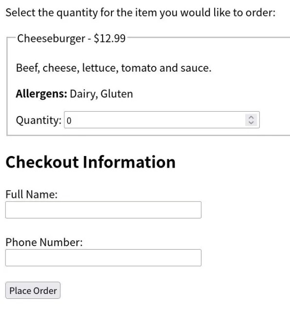
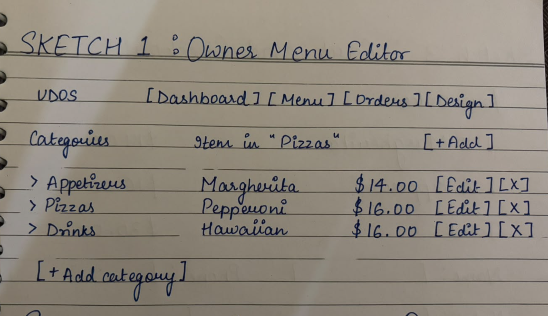
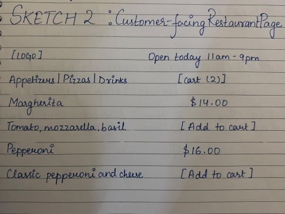
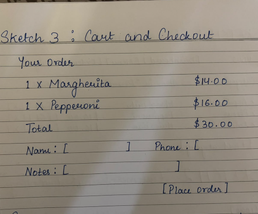
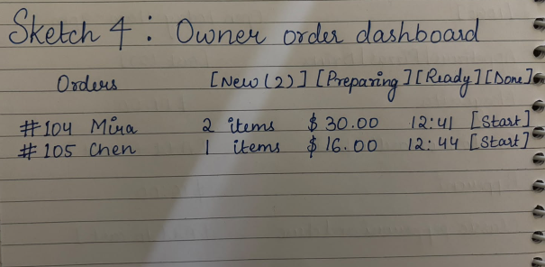

# CSCI 265 Initial Project Proposal

## Team name: 4 Tiny Stars

## Project/product name: EZ Bites

## Contact person and email address

- Jiamiao Zhao, jiamiao.zhao@my.viu.ca *main contact*
- Mira Milat, mira.milat@my.viu.ca
- Chengan Tian, chengan.tian@my.viu.ca
- Brahmi Duklan, brahmi.duklan@my.viu.ca

## Project Overview

We are creating a customizable website for restaurant owners. This allows restaurant owners to launch their own online ordering website without writing any code. Instead of hiring a developer, the owner signs up, fills in a guided form (restaurant name, logo, colours, opening hours, menu categories, menu items, prices, photos) and immediately receives a public personalized ordering website for customers to view and order from. Each dish should include a description, allergens and optional image. At its base, customers will be able to place orders from the restaurant.

We provide one universal website template. Owner inputs are sent to our backend and stored in a database. When a customer visits a restaurant’s page, the server looks up that restaurant’s stored data and injects it into the template, producing a personalized site. Customers can browse the menu, build a cart and place an order. 
The core idea is separating content (stored in the database) from presentation (one shared template), which allows one codebase to serve many restaurants.

## Target audience and motivation

Our project is intended as an easily accessible, simple to use and lightweight website for restaurants and their customers. Restaurants will be able to use our provided template to input their own menu and restaurant information. It is expected to appeal to smaller restaurant owners who may not be able to afford their own custom website, or who just want the appeal of a simple, quick, easy to use template. Customers might like our website as well because it aims to be user friendly and visually sleek.

Primary users: 

**1. Small independent restaurant owners** (cafes, family restaurants, takeout shops, food trucks)

-Have no web developer and little technical skill.
-Cannot afford custom website development.
-Want their own branded ordering page rather than being one listing among hundreds.

**2. Customers**

-Who want a fast, clear, mobile-friendly way to see a menu and place an order

We are interested in making this product as some of us have worked in restaurant environments, and have found their software to sometimes be clunky or hard to use. Our project’s goal is to prioritize ease of use and accessibility for everyone. We’re looking forward to this project as a way of continuing to learn how to design and develop websites. 

More reasons we are interested:
- It is an application that real people could use
- It exercises the full software engineering lifecycle: requirements, database design, backend, front end, authentication, testing
- It has a natural core (template + database) that is achievable in a term and allows us to easily expand the project to add bigger features or scale it back down if we run out of time.

## Key features and discussion

Below includes what the experience of using our website will be like based on the perspective of a restaurant owner vs customer.

**RESTAURANT OWNERS** 

**Registration/log in screen:** The first thing restaurant owners will be directed to do is register for the website with a log in and password. This will allow their data to be saved when they later create their menu using the template. 

**Template Management:** After they have signed in, they will be able to access previously saved templates/menus, or create a new one. If the user has multiple restaurants with different names and menus they’d like to handle, they access all of them from this page. This means that multiple restaurant menus owned by the same person can all be managed here. They can also choose to publish or archive menus from here.

**Using a template:** If the user decides to make a new restaurant template, they will fill in their restaurant’s name, description, address, logo, and phone number. There will be simple theming options like choosing a color scheme and font.

**Menu Management:** Once they have filled out their restaurant’s general info, they can start creating their menu. They can make different categories/sections and input different items into each section. When inputting a menu item it includes the name, description, allergens, price, availability and an optional photo. The website will automatically save their changes as they add items. Each time they update their menu, they will be prompted to re-publish the changes.

**CUSTOMERS**

**Menu Viewing + Cart:** Customers will be able to view a published menu. They can add items to cart to view the total. When placing an order they will be prompted to include their name, phone number, and any other notes. Once they have placed it there will be an order confirmation page and receipt for the customer.

**Possible Other Implementations to Add:**
- Item options/modifiers
- QR code generator linking to the restaurant’s page
- Test mode online payments
- Basic analytics(top selling items, orders per day)
- Rotating menu items/daily specials

## Preliminary interface sketches

This is a simple ordering page, displaying what it might look like to order an item and the checkout page.

The four sketches below are rough text sketches. They show the two sides of the product: the owner side( Sketches 1 and 4) where a restaurant is set up and orders are managed, and the customer side( Sketches 2 and 3), which is the personalized website generated from the owner’s data. The typical flow is: the owner builds the menu in Sketch 1, the customer sees the result in Sketch 2 , the customer checks out in Sketch 3 and the owner receives the order in Sketch 4.

**Sketch 1:  Owner menu editor.** The owner picks a category on the left and edits its items on the right. Changes are saved to the database and appear on the public page. 

**Sketch 2: Customer-facing restaurant page.** This is the shared template filled with one restaurant's stored name, hours, and menu. Every restaurant's page has this layout but different content and colours. 

**Sketch 3: Cart and checkout.** Reached from the "Cart" button in Sketch 2. The customer reviews items, enters contact details, and places the order. 

**Sketch 4: Owner order dashboard.** Orders placed in Sketch 3 arrive here. The owner moves each order through its stages with one click. 

A fifth screen, the **Design page**, will let the owner  enter the restaurant name, upload a logo, choose a colour theme, and set opening hours, with a live preview of the public page beside the form. We will sketch it in more detail once the core screens are settled.

## Scaling plans

**Version 1:** Preset Online Ordering System
Version 1 will function as a simple menu ordering system. We will have a preset restaurant menu in place, and customers will be able to view dishes descriptions and allergens. They will be able to add them to cart and checkout.
Functions: 
-Preset temporary menu
-View dish ingredients/allergens
-Ordering items function

**Version 2:** Customizable Online Menu for Restaurants 
Version 2 will allow for restaurants to input their own information and menu for customers to order from. This will include a log-in page to manage their menu/site ensuring that it is saved. 
Functions: 
- Restaurant registration and log in
- Multiple menu’s management/publication
- Entering template info: name, description, address, logo, phone number
- Input menu items, description, allergens

**Version 3:** Daily Specials / Rotating Menu items
Version 3 will be able to handle daily specials and rotating menu items.
Functions:
-Daily special highlighted menu items
-menu items shown based on given timeframes

**Version 4:** Version 4 will send orders to restaurants and the checkout will be functional
Functions:
- Order dashboard for restaurant
- Functional checkout with orders sent

If the project looks too small, we can test-mode online payments, make a QR code generator for each restaurant, order email notifications, basic sales analytics, multiple selectable templates, and support for other kinds of businesses by letting owners define their own item fields. 

If the project looks too large, we can drop online checkout and treat orders as simple pickup requests (or make the site a display-only menu with a "call to order" button), use one fixed theme instead of customization, remove image uploads, and replace the status workflow with a plain list of orders. In every case the guaranteed minimum is: owner login, a menu editor, and a public restaurant page generated from the database. 

## Risks and potential issues

**One owner seeing or editing another owner's data:** This is the most serious risk in a system shared by many restaurants. **Plan:** scope every database query by the logged-in owner's restaurant, and write specific tests that try to access another restaurant's data. 

**Payment handling:** Real payments bring legal and security burdens. **Plan:** not store any card data; use a provider's test mode only if time permits, otherwise leave payments out (see Scaling plans). 

**Delivery logistics. Our system is scoped to ordering, not delivery:** we do not plan to dispatch drivers, track a delivery in real time, or coordinate delivery-partner logistics, since that is a large problem on its own and outside a term project. **Plan:** support "pickup" orders only for the core product, and treat delivery as, at most, a simple "delivery" order type where the customer enters an address and the restaurant handles the delivery itself outside our system; we will not build routing, driver assignment, or live tracking.

**Image upload problems (large files, wrong file types, storage). Plan:** treat photos as optional, limit file type and size, and build them only after the core works.  

**Database design changes late in the project. Plan:** agree on the schema early as a team, use migration scripts, and review any change before it is merged. 

**Template too rigid or too complicated. Plan:** begin with one template and a small set of theme presets, and avoid a free-form page builder. 

A risk is making the interface too complicated. Our goal is to replace clunky software, so our website must be easy to use. To avoid this problem, we will keep the design simple and test our rough ideas early with basic sketches.

Our project includes advanced coding challenges. These include making one single system work for multiple different clients, like hosting many separate restaurants on one platform and making the website dynamically change what it looks like based on the data it receives.
To try and make this project attainable, we plan to build with tools the team already knows (for example SQLite, HTML templates).
